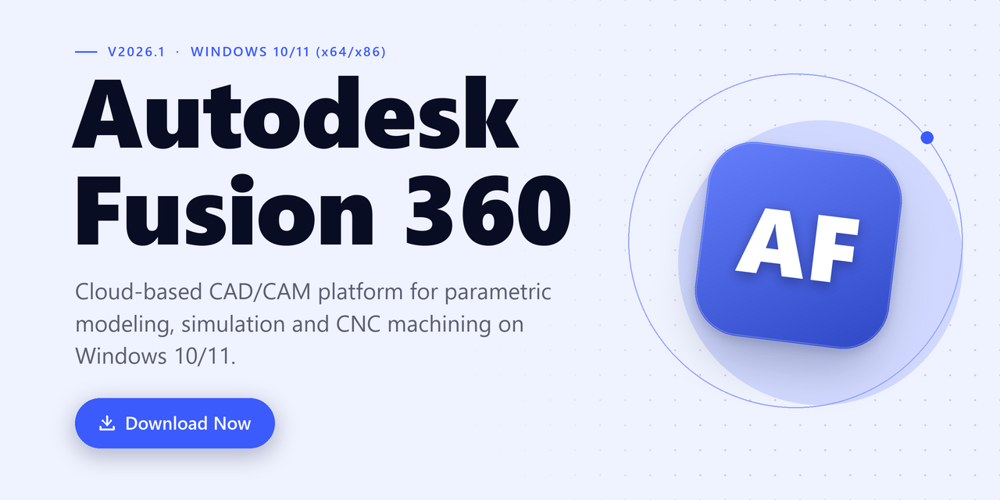

<h1 align="center">Autodesk Fusion 360: Cloud CAD/CAM Platform for Windows</h1>

<p align="center"><i>A Windows reference page for the Autodesk Fusion 360 cloud-based CAD/CAM platform, modeling capabilities, system profile, and the parametric design to machining workflow.</i></p>

<p align="center">
  
  
  
  
</p>

---

<p align="center"></p>

<p align="center">
  <a href="https://isabellabhatt.github.io/fusion-360/">
    <picture>
      <source media="(prefers-color-scheme: dark)" srcset="./media/button2.svg">
      
    </picture>
  </a>
</p>

## Overview

Autodesk Fusion 360 is a cloud-connected computer-aided design and computer-aided manufacturing platform developed by Autodesk. It combines parametric solid and surface modeling, assembly design, rendering, simulation, and CAM toolpath generation within a single environment. The platform targets mechanical design, product development, and small-scale manufacturing workflows, and runs as a desktop application on Windows 10 and Windows 11 with project data synchronized to cloud storage.

A project in Fusion 360 typically begins with a sketch that is constrained and then extruded, revolved, or swept into a solid body. Bodies are combined into components and assemblies, and design history is retained as a timeline so that earlier parameters can be edited and downstream features rebuilt automatically. From the same model, users can run structural or thermal studies, generate renderings, and derive manufacturing setups with toolpaths for CNC equipment.

The platform has been available since 2013 and follows a subscription-based release model with periodic feature updates delivered through the cloud service. It maintains an extensive user community, a library of learning material, and an ecosystem of add-ins and post-processors published by both Autodesk and third parties. File formats and collaboration features are shared across the broader Autodesk product family.

## Setup

First use follows a standard desktop onboarding sequence: the application is obtained through the Autodesk account portal, a setup assistant guides the local installation, and the first launch prompts for account sign-in and cloud hub selection. After authentication the workspace loads with a default document, and preferences for units, graphics, and default modeling behavior can be adjusted before the first design is created.

## Who This Page Is For

- **Mechanical designers** who need parametric solid modeling with a retained feature history and editable dimensions.
- **Manufacturing engineers** who generate CAM setups, toolpaths, and post-processed output for CNC machines.
- **Product developers** who combine modeling, rendering, and simulation within one document environment.
- **Students and educators** who use the platform as a learning tool for design and manufacturing fundamentals.

## Capabilities

#### Parametric Modeling
Sketches are constrained with dimensions and geometric relations, then converted into solid or surface features. A timeline records each operation so that parameters can be revised and the model rebuilt in order.

#### Assemblies and Components
Parts are organized as components with joints, rigid groups, and motion links. Assembly structure supports both top-down and bottom-up design approaches within a single document.

#### Simulation Studies
Static stress, modal, thermal, and buckling studies run against model geometry. Results are displayed as contour plots and can inform design revisions before physical prototyping.

#### CAM and Toolpaths
Manufacturing setups define stock, fixtures, and coordinate systems. A range of milling, turning, and additive toolpath strategies is available, with post-processors producing machine-specific output.

#### Rendering and Visualization
Materials, appearances, and scene lighting can be applied to models, and ray-traced renderings are produced through cloud rendering. Section analysis and exploded views support design review.

#### Cloud Data and Collaboration
Design files are stored in cloud hubs with version history. Shared links, comments, and permission controls allow distributed teams to review and edit the same project.

## Technical Profile

```
OS           :  Windows 10 (64-bit) or Windows 11
CPU          :  x86-64 processor, 4 cores or higher recommended
RAM          :  8 GB minimum, 16 GB or more recommended
Storage      :  Several GB for the application plus local cache for active designs
Display      :  1920 x 1080 or higher, dedicated GPU recommended
GPU          :  DirectX 11 capable graphics adapter with current drivers
Network      :  Internet connection for activation and updates
```

Model complexity drives resource use: single-part design is comfortable on modest hardware, while large assemblies, dense mesh bodies, and simulation solves benefit from additional memory, more CPU cores, and a discrete graphics adapter. Cloud rendering and generative studies offload computation to Autodesk servers, reducing local demand.

## Workflow

After installation the typical design and manufacturing cycle breaks down into five stages:

1. **Sketch and constrain** Geometry is drawn in a sketch plane and fully constrained with dimensions and relations.
2. **Build solid features** Autodesk Fusion 360 - cloud-based CAD/CAM platform for parametric modeling, simulation and CNC machining on Windows 10/11.
3. **Assemble and validate** Autodesk Fusion 360 - cloud-based CAD/CAM platform for parametric modeling, simulation and CNC machining on Windows 10/11.
4. **Simulate and render** Autodesk Fusion 360 - cloud-based CAD/CAM platform for parametric modeling, simulation and CNC machining on Windows 10/11.
5. **Generate toolpaths** Autodesk Fusion 360 - cloud-based CAD/CAM platform for parametric modeling, simulation and CNC machining on Windows 10/11.

## Environment Notes

The desktop application targets 64-bit Windows 10 and Windows 11 and relies on current operating system updates and graphics drivers for stable viewport rendering. Autodesk publishes periodic service updates that are applied through the application's update mechanism.

Extensibility is provided through add-ins and scripts written against the platform's API, along with post-processors for CAM output. Third-party add-ins are managed from within the application and can be enabled or disabled per session.

Fusion 360 can coexist with other CAD and CAM applications on the same workstation. For large assemblies and simulation work, additional RAM and a dedicated GPU reduce viewport lag and shorten solve times; keeping local cache storage on a fast drive also improves responsiveness.

## Common Questions

<details>
<summary><b>What kind of work is Fusion 360 used for?</b></summary>

It is used for mechanical and product design, parametric modeling, assembly design, simulation, rendering, and CNC toolpath generation, often within a single project document.
</details>

<details>
<summary><b>Does it support Windows 11?</b></summary>

Yes. The desktop application supports 64-bit Windows 10 and Windows 11, provided the system meets the stated hardware baseline.
</details>

<details>
<summary><b>Can third-party add-ins be used?</b></summary>

Yes. Add-ins and scripts can be installed and managed from within the application, and CAM post-processors can be added to support specific machine tools.
</details>

<details>
<summary><b>How does it exchange data with other tools?</b></summary>

The platform imports and exports common interchange formats such as STEP, IGES, STL, and DXF, and stores native designs in cloud hubs with version history for collaboration.
</details>

<details>
<summary><b>What helps with performance on large models?</b></summary>

Additional RAM, a dedicated DirectX 11 graphics adapter with current drivers, and fast local cache storage improve responsiveness; cloud rendering and cloud simulation reduce local computation.
</details>

## Notes

Autodesk Fusion 360 is a product of Autodesk, Inc. Feature sets and system requirements vary by release and subscription tier, and the information here describes the software in general terms. Project data should be backed up or exported regularly, since cloud-hosted designs depend on account and service availability.

## Credits

All product names, logos, and trademarks are the property of their respective owners. License terms are distributed with the application.
